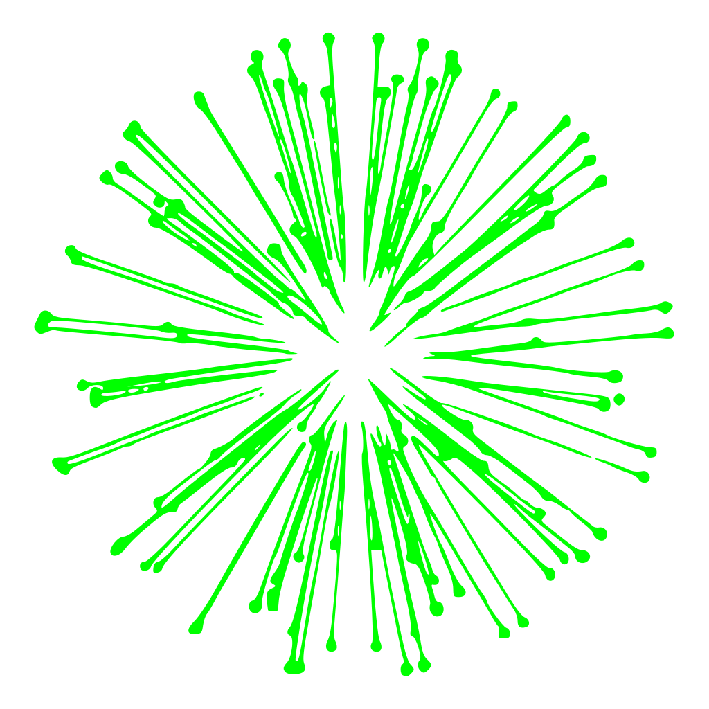

<!-- Intro -->
<br />
<div align="center">
  <h1 align="center">Island Graphics Demo</h1>
  <p align="center"><b>A GPU-Driven Walking Simulator</b></p>
  <div>
  
</div>
</div>

<!-- About -->
## About The Project

After my second year of a CIS degree, I wanted a summer project and chose something ambitious: graphics. I followed the [LearnOpenGL][learn-opengl] tutorials, and [early commits][early-commits] were simple lesson checkpoints. Sometime before PBR, I decided to make a small demo: not a general-purpose engine, but a polished final product.

I created an island in Gaea and Blender, tried populating it with some vegetation, and found my school laptop (running an Intel Iris Xe) was unable to keep up. Thus began the journey to get decent framerates on a very modest system. I tried to do as much work as possible on the GPU and arrived at a full glMultiDrawElementsIndirectCount (MDIC) pipeline.

<!-- Features -->
## Features
* Written against OpenGL 4.6 Core spec, no extensions
* Unified MDIC pipeline for all geometry, including animated geometry, skybox, and shadows
* GPU frustum culling
* GPU Hi-Z culling
* 32-byte packed vertex including vertex color
* Compute shaders:
  * Vertex skinning, written back to main VBOs
  * Particle simulation smuggled inside the 32-byte vertex
  * Vertex explosion (an homage to LearnOpenGL's geometry shader)
  * MSAA depth map resolve
* Cascaded shadow maps
* Settings window on startup
* Load-time cubemap generation
* KTX2 compressed textures, loaded via thread pool
* Jolt Physics
* miniaudio with AABB-based audio triggers, one-shot effects, and character sounds

<!-- Gallery -->
## Gallery

### Screenshots
![Grassy Field Screenshot][grass-screen]
![Space Torus Screenshot][torus-screen]
![Beach Screenshot][beach-screen]

### Vertex Explosion Effect
![Vertex Explosion][explosion-effect]

### Culling Demo
[![GPU Culling Demo][culling-thumb]][culling-video]

## MDIC Pipeline
### Culling
![Culling pipeline][cull-pipeline-light]
![Culling pipeline][cull-pipeline-light]

## Performance

### Intel Iris Xe (Integrated Graphics)

* 1920x1080 resolution
* 2x MSAA 
* 2x anisotropic filtering 
* 1024x1024 shadow maps 
* 512x512 cubemaps

Average FPS: 30-45<br>
Crouched in heavy grass: 25

### GeForce RTX 4080 Super

* 2560x1440 resolution
* 8x MSAA 
* 16x anisotropic filtering 
* 4096x4096 shadow maps 
* 2048x2048 cubemaps

Average FPS: 600-900<br>
Crouched in heavy grass: 550

## Fun Bugs

* Broke the MSVC compiler. Started a [Visual Studio Developer Thread][crash-thread] to report it, worked for months to catch it, and got it moved to "Under Consideration". It appears to be a race condition in link time code generation under partial recompilation. The script to reproduce it commented out a single line of code, compiled, uncommented, then recompiled, in a loop.
* Hi-Z. All of it. Like finding out the debug camera was the one feeding the depth pyramid, not the player camera. I thought Hi-Z had failed again - it turns out, when doing occlusion culling from hundreds of feet in the air, not much gets culled.

## Build Requirements
* Windows operating system
* MSVC: Visual Studio 2026 with the *Desktop development with C++* workload
* CMake 3.26 or higher
* [vcpkg](https://github.com/microsoft/vcpkg), with VCPKG_ROOT set
* x64 Native Tools Command Prompt for Ninja builds

## Runtime Requirements
* MSAA cannot be disabled, 2x minimum.
* OpenGL 4.6 Core, plus the following limits:

| Limit                                | Minimum | Percent Unsupported |
|--------------------------------------|--------:|--------------------:|
| MAX_COMBINED_SHADER_STORAGE_BLOCKS   |   16    |               0.09% |
| MAX_SHADER_STORAGE_BUFFER_BINDINGS   |   16    |               0.09% |
| MAX_VERTEX_SHADER_STORAGE_BLOCKS     |    8    |               0.04% |
| MAX_TEXTURE_IMAGE_UNITS              |   32    |               1.24% |

These limits exceed those guaranteed by 4.6 Core. Percentages are based on devices reporting 4.6 Core capability, from [GPUinfo.org][gpu-info].

## Build Instructions

Clone the repo. Requires [Git LFS][git-lfs].

```
git clone https://github.com/Trichord/Island-Graphics-Demo.git
cd Island-Graphics-Demo
```

Build through CLI or Visual Studio. First build will be slow from vcpkg pulling in dependencies.

### CLI

Build the project using either the Visual Studio generator:

```
cmake --workflow --preset vs-release
```

or Ninja:

```
cmake --workflow --preset release
```

### Visual Studio

Open the directory in Visual Studio, select a preset, and build.

## Running The Demo

After building, the demo sits in ./bin/{Release|Debug}/island_demo.exe

*Note: If your resolution is not listed, run the demo once and settings.json will appear next to the exe. Edit the "renderWidth" and "renderHeight" fields to match your desired resolution.*

### Controls
**WSAD** - Movement<br>
**Mouse** - Look<br>
**Space** - Jump<br>
**Left Ctrl** - Crouch Toggle<br>
**Left Shift** - Sprint Toggle<br>
**Esc** - Quit

## AI Use Disclaimer
The following code is 100% AI generated:
* Build scripts (CMake, vcpkg)
* Blender tools (terrain chunking, position generation)

AI was used heavily for debugging, walking through new algorithms, OpenGL API usage, and providing guidance on architectural decisions. This project would not be what it is without modern tooling. Ultimately, some of my best work came from ignoring AI and just fixing the code that bothered me.

<!-- Markdown links & images -->
[grass-screen]: images/screenshot_1.jpg
[torus-screen]: images/screenshot_2.jpg
[beach-screen]: images/screenshot_3.jpg
[cull-pipeline-light]: images/culling_pipeline_light.svg#gh-light-mode-only
[cull-pipeline-dark]: images/culling_pipeline_dark.svg#gh-dark-mode-only
[explosion-effect]: images/vertex_explosion.webp
[culling-thumb]: https://img.youtube.com/vi/4OVsnVp6WYw/maxresdefault.jpg
[culling-video]: https://www.youtube.com/watch?v=4OVsnVp6WYw
[gpu-info]: https://opengl.gpuinfo.org/
[learn-opengl]: https://learnopengl.com/
[early-commits]: https://github.com/Trichord/Island-Graphics-Demo/pull/1/commits
[crash-thread]: https://developercommunity.visualstudio.com/t/Fatal-error-C1001:-Internal-compiler-err/11055388
[git-lfs]: https://git-lfs.com/